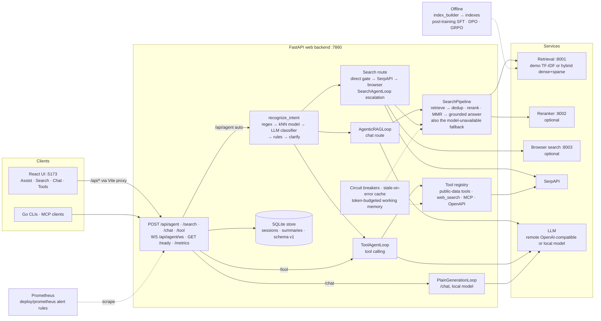
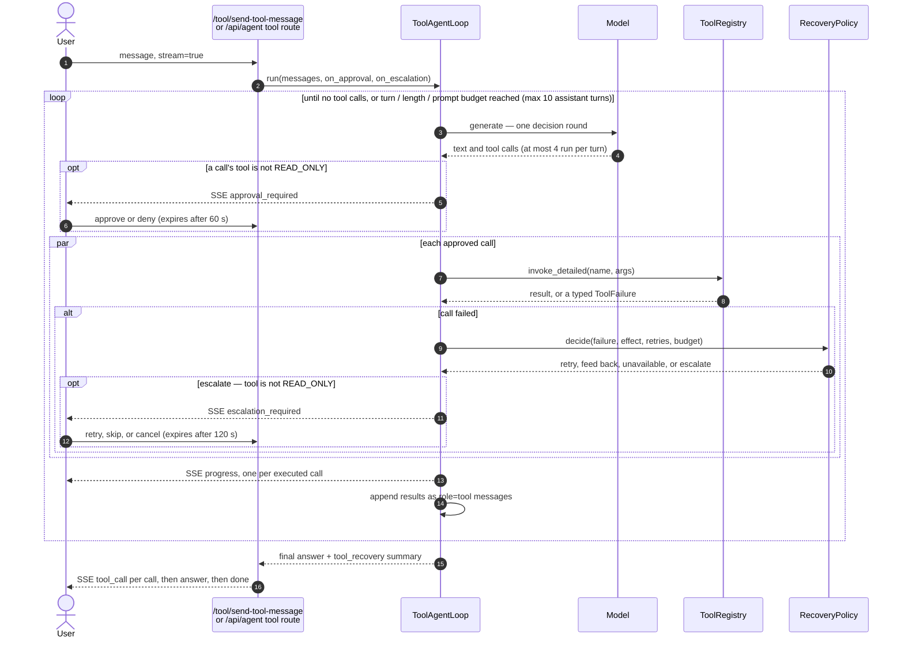
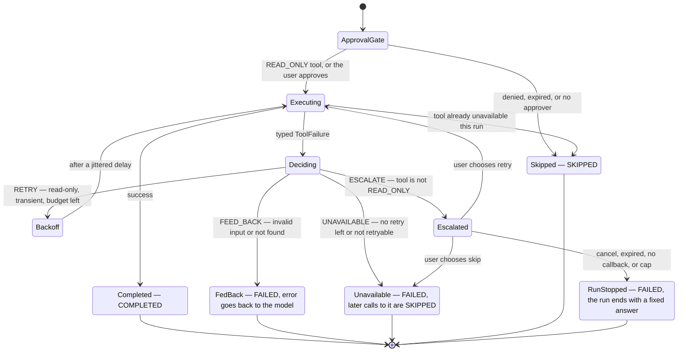

# Agentic Search

Agentic Search is a retrieval-backed platform for building multi-turn search, RAG, and tool-using agents. This repository holds the FastAPI backend, interchangeable retrieval services, and training and evaluation workflows. The React web UI lives in its own repository, [Agentic-Search-UI](https://github.com/lingduoduo/Agentic-Search-UI).

## What it provides

- Agentic RAG with multi-turn search, query enhancement, citations, and grounded synthesis
- Conversation and tool-using agents with routing, memory, and structured tool dispatch
- Dense, sparse, and hybrid retrieval with fusion, reranking, and optimization workflows
- Opt-in [retriever-free document navigation](docs/decision-retrieval.md) inspired by DecisionRAG: local logits-based judgments over topics, documents, sections, and passages, without a dense/sparse index at query time; optional [offline tree construction and incremental maintenance](docs/corpus-hierarchy.md) supports structured and clustered corpora
- Connector data models, document ingestion, and offline index building via the `index_builder` CLI
- Web search through Google Custom Search, SerpAPI, and browser automation
- Search-source agents — twenty source categories (`web`, `academic`, `code`, `social_media`, `resource`, `news`, `official`, `legal`, `financial`, `patent`, `product`, `business`, `local`, `travel`, `media`, `books`, `education`, `events`, `jobs`, `statistics`) that steer a query toward a kind of source. Each category defines its primary search topics and typical sources, which shape a query hint for the configured web providers (a few categories also reach keyless public-data tools); typical sources are descriptive, not dedicated integrations; subjects such as health or gaming are query topics, not categories. Selectable from the HTTP API or the Assist page (default `web`). A request may use up to three categories, searched in parallel with results fused (RRF), reranked and cited; multi-category relevance is not yet measured; `domains: ["auto"]` is opt-in automatic selection; its second evaluation, which credits every acceptable category, passed its pre-registered bar on a small 60-query test set (hit 1.00, pick precision 0.71, 1.5 picks on average; [details](docs/search-engine.md#automatic-category-selection))
- A React UI ([Agentic-Search-UI](https://github.com/lingduoduo/Agentic-Search-UI)) with four surfaces — an auto-routing Assistant plus direct Search, Chat, and Tool pages — with streaming responses, a running conversation transcript, source inspection, and observability panels
- Post-training for search agents — supervised (SFT), preference (DPO), and reinforcement (GRPO) — plus evaluation workflows
- Identity-aware access: signing in narrows results to what you may read and unlocks user-scoped tools and memory, without changing which engine runs
- MCP in both directions — a server exposing search and retrieval to compatible clients, and a client that turns another server's tools into ordinary registry tools

---

## Architecture

The web backend routes each `/api/agent` request to a chat, search, or tool agent; the direct Search, Chat, and Tools pages call their engines without routing. Retrieval, reranking, and browser search run as separate services, and every dependency the agents call is behind a degradation path. See [Architecture](docs/architecture.md) for the repository layout and request flows.



### Tool-calling sequence

How `ToolAgentLoop` runs one request, on the Tools page or the `/api/agent` tool route. Approval and escalation reach the user as SSE events; see [Tool engine](docs/tool-engine.md).



### Tool-call states

What happens to a single tool call. Each end state is the `TaskStatus` recorded for it; the retry, feed-back, unavailable, and escalate branches are `RecoveryPolicy`'s decision.



## Prerequisites

- Python 3.12+
- Node.js 24 and npm
- An LLM provider API key for agent loops
- Java only when using BM25/pyserini
- Docker only for the containerised stack

## Install

From the repository root:

```bash
pip install -e .
pip install -r requirements.txt
```

`requirements.txt` is the serving baseline, and it is what the container image installs. Three companion files add what serving does not need. Install them on top of it as required:

```bash
pip install -r requirements-retrieval-heavy.txt   # faiss-cpu + pyserini, for the FAISS/BM25 backends of retrieval/server.py
pip install -r requirements-training.txt          # datasets/pyarrow for examples/
pip install -r requirements-unit-test.txt         # what CI installs for the unit tests
```

Install the optional MCP dependencies when needed:

```bash
pip install -e ".[mcp]"
```

## Configure

Copy the example environment file, then provide the model settings required by your LLM provider:

```bash
cp .env.example .env
```

```dotenv
GEN_AI_MODEL_PROVIDER=openai
GEN_AI_MODEL_VERSION=gpt-4o-mini
GEN_AI_API_KEY=...
```

Provider, web-search, retrieval, reranking, routing, and application settings are documented in [Configuration](docs/configuration.md). Timeouts and retry budgets live in a validated TOML file. Point `AGENTIC_SEARCH_TIMEOUTS_PATH` at a partial override file to change them; see [Timeout and retry policies](docs/configuration/timeouts.md).

## Run locally

Start each service in a separate terminal from the repository root.

### 1. Start retrieval

**Simplest: skip this step.** The bundled corpora are static, so the API can serve one itself. Start the API in step 2 with `AGENTIC_SEARCH_EMBEDDED_RETRIEVAL` set:

```bash
AGENTIC_SEARCH_EMBEDDED_RETRIEVAL=demo PYTHONPATH=src:. uvicorn src.internal.servers.web.app:app --host 127.0.0.1 --port 7860
```

It takes the same corpus values as `--corpus` below, or a `.jsonl` path. It serves TF-IDF only, at `/retrieval/retrieve` on the API, and refuses callers from other hosts. If the API runs on a port other than 7860, set `AGENTIC_SEARCH_WEB_PORT` to match.

**Or run a separate retrieval server**, for hybrid retrieval or a server several processes share. Run it on port **8001**, where the API looks for it by default:

```bash
python3 -m src.internal.servers.retrieval.demo --corpus demo
```

To change what it serves, pick a server and a corpus.

**Server** (both serve the same API on port 8001, so either works with the backend):

| Module | Retrieval | Notes |
|--------|-----------|-------|
| `src.internal.servers.retrieval.demo` | TF-IDF | No model download |
| `src.internal.servers.retrieval.hybrid` | Dense e5 + TF-IDF, fused with RRF | Downloads e5 on first start; `--no-dense` runs TF-IDF only |

**Corpus** (required, exactly one):

| Flag | Serves |
|------|--------|
| `--corpus demo` | The curated 20-document ML corpus (`data/corpus.jsonl`) |
| `--corpus all` | The union of every corpus registered in `data/corpora.json` |
| `--corpus <name>` | One registered corpus, such as a BEIR dataset added below |
| `--corpus_path <file.jsonl>` | An unregistered corpus file |

To add a BEIR benchmark corpus, install `beir` and run the converter. It registers the dataset, so you can serve it by name right away:

```bash
python3 -m examples.beir_to_corpus --dataset nfcorpus
python3 -m src.internal.servers.retrieval.demo --corpus nfcorpus
```

**Optional services.** Start each in its own terminal, then set its variable on the API in step 2:

| Service | Command | API variable |
|---------|---------|--------------|
| Cross-encoder reranker: reranks retrieved documents before display | `python3 -m src.internal.servers.retrieval.rerank --port 8002` | `AGENTIC_SEARCH_RERANK_URL=http://localhost:8002/rerank` |
| Browser web search: fallback for the `web_search` tool when SerpAPI fails | `python3 -m src.internal.servers.web_search.browser --port 8003` | `AGENTIC_SEARCH_BROWSER_SEARCH_URL=http://localhost:8003/retrieve` |

The browser search server needs no API key, but it is slow. It runs only on the host: it wraps the `playwright-cli` binary, which is not a pip package and is not in the container image, and it refuses to start without it. The `/api/agent` search route also has a browser step, but nothing sets its URL from the environment yet.

### 2. Start the API

The FastAPI backend runs on port **7860**:

```bash
PYTHONPATH=src:. uvicorn src.internal.servers.web.app:app --host 127.0.0.1 --port 7860
```

With optional services, set their variables on the same command:

```bash
AGENTIC_SEARCH_RERANK_URL=http://localhost:8002/rerank \
AGENTIC_SEARCH_BROWSER_SEARCH_URL=http://localhost:8003/retrieve \
PYTHONPATH=src:. uvicorn src.internal.servers.web.app:app --host 127.0.0.1 --port 7860
```

### 3. Web UI (optional)

The web UI is a separate repository, [Agentic-Search-UI](https://github.com/lingduoduo/Agentic-Search-UI). Its README covers installing and running it against this backend on port 7860.

## Verify the stack

Check retrieval against the bundled corpus:

```bash
curl -s -X POST http://127.0.0.1:8001/retrieve \
  -H 'Content-Type: application/json' \
  -d '{"query": "what is FAISS?", "topk": 5}' | python3 -m json.tool
```

Check the API health endpoint:

```bash
curl -s http://127.0.0.1:7860/health | python3 -m json.tool
```

`/health` reports only that the process is up. `/ready` also checks that the store and the retrieval service are reachable. It returns 200 when both are, and otherwise 503 with the failing check named:

```bash
curl -s http://127.0.0.1:7860/ready | python3 -m json.tool
```

Prometheus metrics are always recorded, but `GET /metrics` is mounted only with `AGENTIC_SEARCH_METRICS_ENABLED=1`. Alert rules ship in `deploy/prometheus/`. See [Operational metrics](docs/observability-metrics.md).

## Run with Docker

`docker/docker-compose.yml` runs the retrieval server (port 8000 inside the stack), the web backend (API only) on port 7860, and Postgres and Redis. The containers run as a non-root user:

```bash
docker compose --env-file .env -f docker/docker-compose.yml up --build
```

To include the web UI, clone [Agentic-Search-UI](https://github.com/lingduoduo/Agentic-Search-UI) next to this repository and add the `frontend` profile. That builds the UI's nginx image, which serves the app on port 8080 and proxies API calls to the backend:

```bash
docker compose --env-file .env -f docker/docker-compose.yml --profile frontend up --build   # UI at http://localhost:8080
```

See [Frontend](docs/frontend.md) for how to point it at a different checkout or a published image.

`--env-file .env` supplies the LLM settings (`GEN_AI_*`) and `SERP_API_KEY` from your `.env`. Only the keys the compose file names reach the containers; host-only values such as `localhost` service URLs stay out. Without it, the containers run with an empty LLM key. The browser search server is host-only and is not available under compose.

Every CI-passed `main` commit is also published to GHCR as a public multi-arch image. Its immutable `sha-<commit>` tag is the handle for deploying and rolling back. See [Deploy and roll back](docs/deploy.md), which also covers the store's schema version on rollback.

## Search engine

The search agent classifies each request, tries internal retrieval first, and falls through to web search when evidence is weak. It also exposes a dedicated retrieval-only surface at `POST /search/send-search-message` (the **Search** page, `/search`). See [Search engine](docs/search-engine.md) for capabilities and request routing.

A request may name a **search-source category** — `financial`, `academic`, `legal`, `news`, and so on — in the `domain` field of `POST /api/agent` (or up to three in `domains`, fused with RRF; `["auto"]` is opt-in selection) or from the Assist page's "Search source" selector; `GET /api/search-domains` lists all twenty, each with its primary topics and typical sources. Typical sources (SEC EDGAR, arXiv, GitHub, …) describe the source family a category aims at; they are not dedicated integrations — every category searches through the configured web providers, with a category hint appended to the query, and `web` is the default and adds nothing. Sixteen categories also list source sites, and by default their web search also queries those sites in parallel, keeping only results from the listed hosts and topping up with the hint query when fewer than three usable ones come back (`AGENTIC_SEARCH_CATEGORY_SITES=false` turns this off). A 48-query confirmatory run measured it better than the hint alone (+0.094 authority precision, p=0.005, gains concentrated in code, social media, events, jobs and financial); it sends two provider calls per category query and can add up to about two seconds (see [Category source sites](docs/search-engine.md#category-source-sites)). The hint steers the query; it is not a result filter. A non-`web` category is only honoured by the `search_tool` and `hybrid_search` modes, or by auto when `mode` is omitted; any other mode rejects it with a 400 rather than ignoring it silently. The previous topic identifiers (`general`, `finance`, `health`, …) are still accepted as aliases. The same taxonomy also routes the agent's own `search_domain` tool to a capability — web search, or one of the keyless public data tools — but that is the tool path, not this one. See [Search-source agents](docs/search-engine.md#search-source-agents).

## Chat engine

The chat agent answers conversational requests with retrieval-grounded synthesis and multi-turn memory. A direct `POST /chat/send-chat-message` endpoint (the **Chat** page, `/chat`) calls the local model with no retrieval, streaming a multi-turn transcript. See [Chat engine](docs/chat-engine.md) for capabilities and routing.

Conversation history is token-budgeted. Each surface keeps the newest messages that fit `AGENTIC_SEARCH_MEMORY_HISTORY_TOKENS` (default 2500, and never more than 40). Older turns are summarized, which is on by default for `/api/agent` and opt-in for `/chat` and `/tool` via `AGENTIC_SEARCH_MEMORY_COMPRESSION=1`, because those two answer with the local model.

When the model is unavailable (connection error, timeout, or an open circuit breaker), the surfaces degrade instead of failing:

- `/api/agent` falls back to a search-only answer and records `hook_metadata.route_degraded = "model_unavailable"`.
- `/tool` lists what the corpus search found.
- `/chat` returns a short "temporarily unavailable" notice.

Both `/tool` and `/chat` mark the response with `degraded`, and the UI shows a notice on those pages.

---

## Tool engine

The tool agent runs multi-turn function calling with structured tool dispatch over a registry of built-in and OpenAPI-backed tools. A dedicated `POST /tool/send-tool-message` surface (the **Tools** page, `/tools`) streams tool calls, gates tools with approval prompts, and fetches the web via a serpapi→browser cascade. See [Tool engine](docs/tool-engine.md) for capabilities, routing, and the tool registry.

Every call's arguments are validated against the tool's full JSON Schema, including ranges, enums, array items, and closed objects. A call that breaks the schema is rejected, not clamped. A failed call goes to `RecoveryPolicy`, shown in the diagrams above. `/api/agent` sessions can also be driven over a WebSocket (`POST /api/agent/ws-token`, then `WS /api/agent/ws`) that carries the same events as the SSE stream.

### Built-in public data tools

The tool agent ships nine keyless public data-source tools, seeded by
`src/internal/tools/public_data/`. They need no API keys or configuration:

| Tool | Source |
| --- | --- |
| `search_wikipedia` | Wikipedia action API |
| `search_arxiv` | ArXiv export API |
| `search_wayback` | Internet Archive CDX API |
| `get_weather` | Open-Meteo |
| `get_stock_quote` | Yahoo Finance chart API |
| `get_crypto_price` | CoinGecko |
| `convert_currency` | exchangerate-api.com |
| `search_location` | Nominatim (OpenStreetMap) |
| `search_nearby_places` | Overpass (OpenStreetMap) |

The first three are citeable: they answer with `{title, content, url}` records,
so their results appear as source cards on `/tools`. The rest answer with a
JSON object of facts. A transient upstream failure on a GET is retried first. Any
failure that remains returns `{"error": ...}` from that one tool and leaves the
turn intact.

## Ingestion

The offline `index_builder` turns a corpus into the searchable sparse/dense indexes that queries read at request time — chunking, embedding, and writing the index artifacts. Chunking offers three strategies, one at a time: a default paragraph-and-section splitter, plus opt-in **recursive** (structure-aware — keeps code blocks and tables intact and splits prose down a Markdown heading hierarchy) and **semantic** (embedding-similarity) modes. Recursive and semantic are mutually exclusive. See [Ingestion](docs/ingestion.md) for the pipeline and connector data models, and [Retrieval](docs/retrieval.md#chunking) for chunking details.

## Common development commands

```bash
pytest                              # backend unit and regression tests
```

See [Testing](docs/testing.md) for focused suites and integration-test prerequisites.

---

## Documentation

- [Architecture](docs/architecture.md) — repository layout, agent families, routing, and request flows
- [Search engine](docs/search-engine.md) — search-agent capabilities and request-routing overview
- [Chat engine](docs/chat-engine.md) — chat-agent capabilities and routing overview
- [API request routing](docs/request-routing.md) — modes, intent classification, provider order, fallbacks, and response metadata
- [Tool engine](docs/tool-engine.md) — tool-agent capabilities, routing, and the tool registry
- [Retrieval](docs/retrieval.md) — retrieval services, indexing, reranking, tuning, and query transformation
- [Ingestion](docs/ingestion.md) — connector data models and the offline `index_builder` indexing tool
- [HTTP API reference](docs/api-reference.md) — local retrieval, web, chat/session, and health endpoints
- [Training and evaluation](docs/training-and-evaluation.md) — examples, datasets, SFT, DPO, GRPO, and benchmarks
- [Frontend](docs/frontend.md) — the separate web UI repository, and what the backend provides for it
- [Command-line tools](docs/cli.md) — the Go `query` + `memory` CLIs, build, usage, auth, and exit codes
- [MCP server](docs/mcp.md) — installation, transport, client configuration, tools, and resources
- [Configuration](docs/configuration.md) — environment variables for providers, services, retrieval, and routing
- [Timeout and retry policies](docs/configuration/timeouts.md) — the bundled `timeouts.toml`, operator overrides, and validation rules
- [Deploy and roll back](docs/deploy.md) — published GHCR image tags, deploying a tag, and rolling back with the store's schema version
- [Operational metrics](docs/observability-metrics.md) — `/metrics`, each metric's definition, PromQL, and alert rules
- [Authentication](docs/authentication.md) — bearer tokens, registration, and route protection
- [Workload identity](docs/workload-identity.md) — automated-client authentication, production safeguards, and renewable Redis IAM credentials
- [Testing](docs/testing.md) — backend unit and regression tests, integration tests, and debugging commands
- [Self-review task reports](docs/development/self-review-reports.md) — validated implementation handoffs and mandatory review gates
